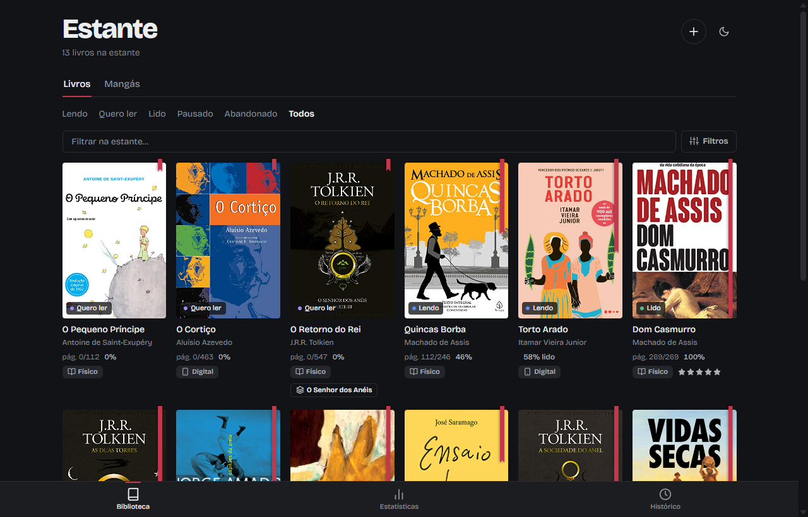
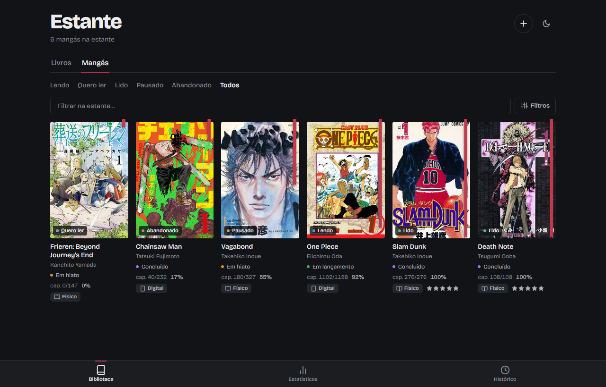

# Estante

App pessoal para acompanhar leituras de livros e mangás: o que estou lendo, o que já li, quanto li por semana e quando sai capítulo novo dos mangás que acompanho. Uso no celular e no computador, com a mesma estante sincronizada nos dois.

**[Abrir a demonstração](https://minha-estante.lucastapajos.workers.dev/?demo)**: uma estante de exemplo que roda só no seu navegador, sem login. O que você mudar fica salvo nele e não chega a lugar nenhum.



## O que faz

- Livros e mangás em abas, com cinco status (lendo, quero ler, lido, pausado, abandonado), grade ou lista e filtros por gênero, formato, ano de leitura, autor e coleção.
- Cadastro pela busca: título ou ISBN no Google Books, na Open Library e na BrasilAPI; mangás na MangaBaka, que traz capa, sinopse e capítulos lançados.
- Progresso por página, por capítulo ou pela posição do Kindle. Cada avanço vira uma sessão de leitura, que alimenta o histórico, as estatísticas (volume por semana, mês e ano, sequência de dias, meta anual) e a retrospectiva do ano.
- Fila "Próxima leitura", coleções, nota e resenha.
- Aviso de capítulo novo: um robô no GitHub Actions consulta a MangaBaka a cada 6 horas e manda uma notificação push, mesmo com o app fechado.
- Funciona offline e pode ser instalado como app (PWA).



## Como é feito

| Parte | Como |
|---|---|
| Interface | HTML, CSS e JavaScript sem framework e sem build. Fontes hospedadas no próprio site. |
| Dados | [`store.js`](store.js) isola o armazenamento: Supabase (login, sincronização entre aparelhos, regras de acesso por usuário no banco) ou `localStorage`, com a mesma interface. A demonstração usa o segundo, com os dados de [`demo.js`](demo.js). |
| Banco | Postgres no Supabase. Esquema em [`db/schema.sql`](db/schema.sql) e mudanças em `db/migration_*.sql`. |
| Buscas | [`apis.js`](apis.js): Google Books, Open Library, BrasilAPI e MangaBaka, com reservas quando uma fonte falha. |
| Avisos | [`robo/check_chapters.py`](robo/check_chapters.py) roda em [`check-chapters.yml`](.github/workflows/check-chapters.yml) e envia Web Push. As chaves secretas ficam nos segredos do GitHub, nunca no código. |
| Publicação | Cloudflare Workers, a cada push na `main`. |
| Segurança | Política de conteúdo (CSP) que só libera as APIs usadas; a chave do Google Books aceita pedidos só deste endereço. Detalhes em [`REVISAO-TECNICA.md`](REVISAO-TECNICA.md). |

## Rodar local

```bash
python -m http.server 5500
```

Abra <http://localhost:5500/?demo>. Sem o `?demo` e sem chaves do Supabase em `config.js` (modelo em [`config.example.js`](config.example.js)), o app usa uma estante vazia no navegador.

Guias: [`SETUP-NUVEM.md`](SETUP-NUVEM.md) (Supabase), [`SETUP-PUSH.md`](SETUP-PUSH.md) (avisos) e [`DEPLOY.md`](DEPLOY.md) (publicação).

---

Projeto pessoal de Lucas Tapajós. Capas e dados das obras vêm das APIs citadas acima.
